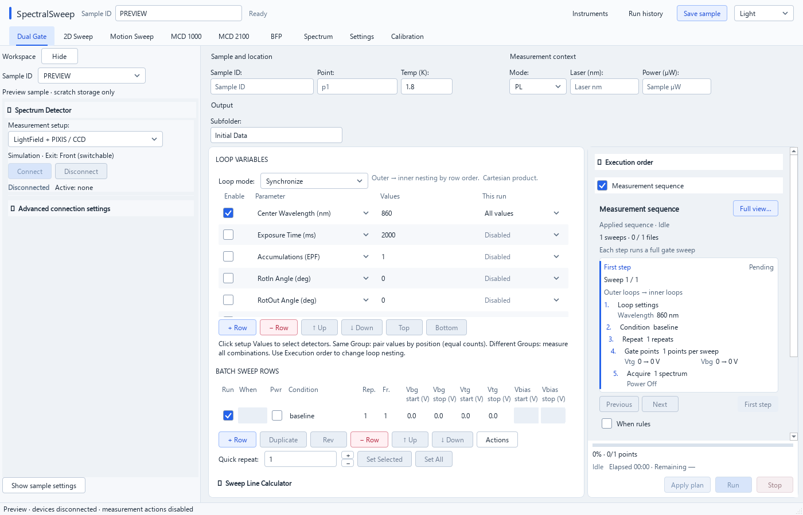

# SpectralSweep

**English** | [简体中文](README.zh-CN.md)

[](https://github.com/ylylyl98/SpectralSweep-pyside6/actions/workflows/windows-release.yml)

A Windows desktop application for spectrum acquisition and coordinated voltage,
motion and magnet measurements, built with PySide6 and Qt Quick.

[Download Windows Setup](https://github.com/ylylyl98/SpectralSweep-pyside6/releases) ·
[Installation and official downloads](docs/installation.md) ·
[Report a problem](https://github.com/ylylyl98/SpectralSweep-pyside6/issues)



*Isolated preview with synthetic settings; devices are disconnected and measurement actions are disabled.*

## Features

- View, compare and export spectra from LightField, Andor Si/InGaAs and supported WinSpec setups.
- Plan Dual Gate measurements with nested loops, batch conditions and a step-by-step sequence preview.
- Coordinate 2D voltage sweeps, motion sweeps, BFP workflows and MCD measurements.
- Manage per-sample settings, run history, CSV output and experiment metadata.
- Use light/dark themes and preview all nine workspaces without connecting instruments.

## Quick start

| Your goal | What you need |
| --- | --- |
| Run the desktop app | The recommended **Setup.exe** from **Releases**, or the portable ZIP. Both include Python, Qt and application Python packages. |
| Connect instruments | Install **only the drivers and vendor software for your equipment**, listed below. |
| Run or modify the source | **Python 3.13 x64** and the repository; Git is recommended for updates. |
| Set up the supported ST133 WinUSB backend | A separately supplied private runtime ZIP; the documented setup/validation workflow currently uses source and Python. |

### Windows installer (recommended)

1. Open [Releases](https://github.com/ylylyl98/SpectralSweep-pyside6/releases). Builds from `main` are marked **Pre-release**.
2. Under **Assets**, download `SpectralSweep-<version>-windows-x64-Setup.exe` and its `.exe.sha256` file.
3. Close SpectralSweep and its worker normally, then run Setup. It installs for the current user, adds a Start menu shortcut and offers an optional desktop shortcut. Administrator rights are not required for the app installation.
4. Complete the [first-run checklist](docs/installation.md#first-run) before connecting equipment.

The default installation folder is `%LOCALAPPDATA%\Programs\SpectralSweep`.
Upgrading and uninstalling preserve user configuration and acquired data.
Setup requires running app/worker processes to close; it does not close them for you or launch the app afterward.
The published app targets Windows x64; Windows 11 x64 is the documented lab deployment.
EXE users do not need a separate Python, Git, pip, PySide6 or PyInstaller installation.

The portable alternative remains `SpectralSweep-<version>-windows-x64.zip` plus `.zip.sha256`.
Extract it completely and retain `SpectralSweep-worker.exe` and `_internal` beside `SpectralSweep.exe`.
To explore the interface with disconnected devices, run from the installed or extracted folder:

```powershell
.\SpectralSweep.exe --preview-workspaces
```

### Updates

Use **Help > Check for updates…** for a manual check. Published builds check by default
while running, normally no more than once every six hours. Preview builds include
pre-releases by default; stable builds check stable releases only. This dialog also provides
automatic-check and channel options; the status bar's **Updates** item opens the same dialog.
Automatic update dialogs wait while a measurement is active.

An update check only offers the [official release page](https://github.com/ylylyl98/SpectralSweep-pyside6/releases).
It does not download, install or restart anything. Stop measurement and close the app
normally before running the new Setup. **Older builds need one manual upgrade to
obtain this update reminder.** Source checkouts are updated through Git.
See [upgrading and update checks](docs/installation.md#updates).

### Source checkout

Install [Python **3.13 x64**](https://www.python.org/downloads/windows/) and
[Git for Windows](https://git-scm.com/install/windows), then run:

```powershell
git clone https://github.com/ylylyl98/SpectralSweep-pyside6.git
Set-Location SpectralSweep-pyside6
py -3.13 -m venv .venv-pyside6-313
.\.venv-pyside6-313\Scripts\python.exe -m pip install -r requirements-quick.txt
.\.venv-pyside6-313\Scripts\python.exe main.py --preview-workspaces
```

For ordinary source launches, use `launch.bat` in the repository root.
It selects the managed environment and checks Python dependencies when they change.
`--mock` simulates the spectrometer; `--preview-workspaces` is the isolated
preview with device operations disabled. See [installation](docs/installation.md#source).

## What users must install themselves

**Python packages and DLL files do not replace Windows device drivers, vendor
applications, matching SDKs or a vendor-required .NET runtime.**
Choose the rows matching your equipment. The [installation guide](docs/installation.md)
provides official download links, configuration steps and checks for each row.

| Equipment / backend | Install or obtain separately | Setup |
| --- | --- | --- |
| Princeton Instruments + LightField | Licensed **LightField + Automation components**, camera/spectrograph drivers and its required .NET Framework. PICam alone does not replace LightField Automation. | [LightField](docs/installation.md#lightfield) |
| Andor SDK2 + Shamrock | Matching camera/spectrograph drivers and SDK2/Shamrock components as needed. Bundled DLLs do not install device drivers. | [Andor](docs/installation.md#andor) |
| Keithley / VISA instruments | **NI-VISA** or a compatible system VISA implementation, plus the USB/GPIB interface driver; NI GPIB may need NI-488.2. | [VISA](docs/installation.md#visa) |
| Thorlabs PM100D | VISA-compatible device driver and VISA runtime. If OPM assigned TLPMX, use Driver Switcher for the **NI-VISA/PM100D** path used by this GUI. | [PM100D](docs/installation.md#pm100d) |
| Thorlabs MFF101 | Matching FTDI **D2XX** driver. This backend does not require the Kinesis application/.NET SDK. | [MFF101](docs/installation.md#mff101) |
| Elliptec / Newport ESP300–301 | Elliptec USB **VCP/COM** driver; for Newport, VISA plus its matching USB/serial/GPIB driver. | [Motion](docs/installation.md#motion) |
| attoDRY1000 / APS100 | Matching virtual-COM driver from the instrument supplier and VISA runtime. | [Magnet](docs/installation.md#magnet) |
| attoDRY2100 | A firmware-compatible Python SDK. A `CRYO2100` copy is included; obtain a matching vendor version if needed. Set its actual directory on this PC. | [Magnet](docs/installation.md#magnet) |
| NI DAQ hardware | **NI-DAQmx system driver only when using NI DAQ analog I/O**; VISA-controlled SMUs alone do not require it. | [DAQ](docs/installation.md#daq) |
| ESP32 imaging stage | Project `stage-v2` firmware and the board's actual USB-serial driver. PlatformIO is needed only to build/flash firmware. | [ESP32](docs/installation.md#esp32) |
| WinSpec / ST133 InGaAs | A working legacy remote camera service, or the private WinUSB runtime and binding using the documented source workflow. Integrated operation still uses LightField for the spectrograph. | [WinSpec](docs/installation.md#winspec) |

## First-run configuration

1. Confirm device discovery in Windows and the appropriate vendor utility.
2. In **Settings / Instruments**, select this PC's devices, SDK paths and addresses.
3. Choose a writable output folder and sample ID. Check optical-path mappings;
   keep optional MFF101 automatic routing off if no flipper is installed.
4. Save the configuration, connect the intended devices and verify a small acquisition
   and its saved output before starting a sweep.

User settings live at `%APPDATA%\SpectralSweep\config.json`.
Re-enter PC-specific COM/VISA addresses, SDK paths and network settings on a new computer.
See [first-run details and troubleshooting](docs/installation.md#first-run).

## Documentation

| Topic | Guide |
| --- | --- |
| Installation, official downloads and troubleshooting | [English](docs/installation.md) · [中文](docs/installation.zh-CN.md) |
| Detailed operation, numeric syntax, sample settings and metadata | [Usage reference](docs/usage-reference.md), with original English/Chinese sections retained |
| Dual Gate planning and multiple setups | [Sequence review](docs/dual-gate-sequence-review.md) · [Multi-setup measurements](docs/dual-gate-multi-setup.md) |
| Spectrum comparison and recovery | [Comparison](docs/spectrum-comparison.md) · [LightField recovery](docs/lightfield-capture-recovery.md) |
| Motion devices | [Newport](docs/newport-rotation.md) · [ESP32](docs/esp32-imaging-stage-trial.md) |
| WinSpec / ST133 | [Remote side-port setup](docs/winspec-side-port.md) · [Windows 11 migration (中文)](docs/st133-new-pc-setup.md) |
| Qt Quick and release automation | [UI migration](docs/qt-quick-migration.md) · [Layout review](docs/qt-quick-layout-review.md) · [Release workflow (中文)](docs/windows-release.md) |
| Maintenance and historical material | [Tools](tools/README.md) · [Reference files](docs/reference/README.md) |

## Development and validation

The current Windows CI baseline is **Python 3.13 + PySide6 6.11.0**.

```powershell
.\.venv-pyside6-313\Scripts\python.exe -m pip install -r requirements-ci.txt
.\.venv-pyside6-313\Scripts\python.exe tools/run_ci_tests.py
.\.venv-pyside6-313\Scripts\python.exe tools/build_exe.py --version local
.\.venv-pyside6-313\Scripts\python.exe tools/build_installer.py
```

Building Setup additionally requires the Inno Setup compiler; ordinary users do not need it.

[GitHub Actions](https://github.com/ylylyl98/SpectralSweep-pyside6/actions/workflows/windows-release.yml)
runs the full test set in four isolated module groups alongside the Windows build.
Publication requires successful tests and a relocated EXE audit covering all nine
workspaces, resources, worker entry points and page-reload sources.
The installer must also pass isolated install, upgrade, installed-app smoke and uninstall checks.
Tests with unmet prerequisites report their skips. CI does not validate physical
acquisition, temperature control or magnet motion.

Pushes to `main` publish a versioned **pre-release** after these gates pass;
`v*` tags publish formal releases. See the [release guide](docs/windows-release.md).

For a problem report, include the build's `version.json`, device/backend,
connection method, reproduction steps and relevant error text in
[Issues](https://github.com/ylylyl98/SpectralSweep-pyside6/issues).
